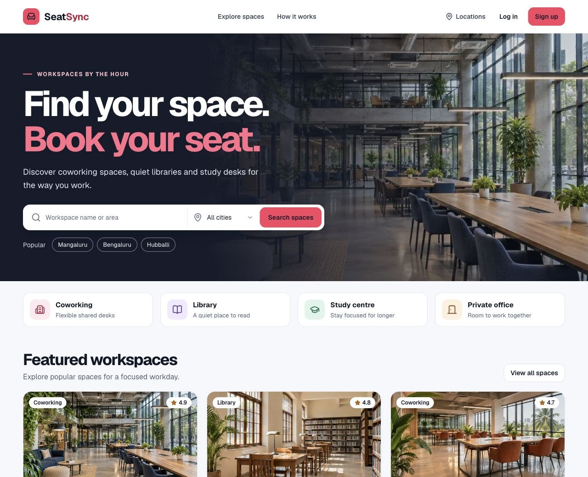

# SeatSync

**Find your space. Book your seat.**

SeatSync is a learning project for a distributed workspace reservation platform. Through Phase 8, it includes a PostgreSQL-backed catalog of eight fictional workspaces across Mangaluru, Bengaluru and Hubballi, plus registration, login, a private account page and administrator access checks. The seat picker reads live layouts, upcoming slots and seat availability from PostgreSQL. Discovery cards still display their labeled sample ratings and counts. Signed-in users can hold multiple seats atomically, see their deadline and cancel before the slot begins. Redis helps coordinate competing requests when configured. PostgreSQL still decides ownership and expiry. Easebuzz sandbox checkout verifies test payments before booking and supports retry-safe holds and confirmations. Members can manage their bookings, and administrators can view live metrics and manage inventory.



## Run locally

Use Node.js 22.12 or later in the 22 release line, or Node.js 24 or later, with npm. Choose a local PostgreSQL database or a Neon development database.

```bash
npm ci
cp .env.example .env
```

Create an `AUTH_SECRET` with `openssl rand -hex 32` and paste it into `.env`. Keep `AUTH_URL` set to the origin that you open in the browser. For the commands below that is `http://localhost:3000`.

- **Docker Compose.** Generate a separate local password with `openssl rand -hex 24`. Set `POSTGRES_PASSWORD` to that value, and set `DATABASE_URL` to `postgresql://seatsync:<password>@localhost:5432/seatsync` with the same password. Run `docker compose up -d --wait db`.
- **Existing PostgreSQL server.** Create an empty development database and set `DATABASE_URL` to its PostgreSQL connection URL.
- **Neon.** Set `DATABASE_URL` to the pooled connection string and `DIRECT_URL` to the direct connection string for the same development database. Use `sslmode=verify-full` in the pooled URL to explicitly verify the server certificate and hostname. Preserve the URL’s other parameters. [Prisma PostgreSQL guide](https://www.prisma.io/docs/orm/v7/core-concepts/supported-databases/postgresql) · [PostgreSQL TLS modes](https://www.postgresql.org/docs/current/libpq-ssl.html)

```bash
npm run db:deploy
npm run db:seed
npm run dev
```

Open [SeatSync on localhost](http://localhost:3000). If the local sandbox blocks Turbopack’s CSS worker socket, use `npm run dev -- --webpack`. The same fallback is available for `npm run build -- --webpack`.

`db:deploy` applies committed migrations. When you deliberately change the Prisma schema, use `npm run db:migrate -- --name your_change` on a development database to create a new migration, inspect its SQL, and regenerate with `npm run db:generate`.

## Redis settings

Use the connection URL by itself for `REDIS_URL`, for example `redis://127.0.0.1:6379` for local development. Start local coordination Redis with `docker compose up -d redis`.

`REDIS_CACHE_URL` is optional and can stay empty when you have one Redis service. For a separate local cache, run `docker compose --profile cache up -d redis-cache` and use `redis://127.0.0.1:6380`. `APP_INSTANCE_ID` is optional too. The app generates a process label if it is blank and includes it in reservation responses.

## Accounts and authorization

Register at `/account?mode=register` and log in at `/account`. New registrations get the `USER` role. In your own development database you can grant admin access to an existing account:

```bash
npm run db:grant-admin -- your-account@example.test
```

The authenticated `/admin` page reads the current role from PostgreSQL. `GET /api/account/me` derives identity from the session and returns only that user’s profile. Phase 2 is intended for local development. Email verification, recovery and production rate limiting are future work.

## Verify the project

```bash
npm test              # Validation and password tests, independent of PostgreSQL
npm run test:integration  # Use a dedicated, migrated and seeded development database
npm run db:validate
npm run lint
npm run typecheck
npm run build
```

## Follow the code

- [Phase 5 walkthrough](docs/phase-5.md) covers Redis keys, locking, TTL hints, safe release, caching and local tests.
- [Phase 6 walkthrough](docs/phase-6.md) covers Easebuzz sandbox setup, payment verification and idempotent requests.
- [Phase 7 walkthrough](docs/phase-7.md) covers member bookings, admin inventory, live metrics and page transitions.
- [Phase 8 walkthrough](docs/phase-8.md) covers the engineering lab, isolated local setup, and measured distributed k6 tests.
- [Phase 4 walkthrough](docs/phase-4.md) follows a seat hold through PostgreSQL row locks, expiry, confirmation and cancellation.
- [Phase 3 walkthrough](docs/phase-3.md) explains the seat map, live availability, timezone handling and polling.
- [Phase 2 walkthrough](docs/phase-2.md) explains the migration, the seed, PostgreSQL-backed discovery, and the login and role checks.
- [Phase 1 walkthrough](docs/phase-1.md) records how the discovery interface was built.
- [Architecture and database design](docs/architecture.md) covers the dependencies, data model and remaining phases.
- [Environment template](.env.example) shows which settings are needed now and which are for later phases.

## API

| Request | Behavior |
| --- | --- |
| `GET /api/workspaces` | Paginated PostgreSQL catalog with `q`, `city`, `category`, `min`, `max`, repeated `amenity`, `available=1`, `sort` and `page` |
| `GET /api/workspaces/[id]` | One public workspace by slug, such as `the-reading-room` |
| `GET /api/workspaces/[id]/seats` | Seat categories, positions and prices in paise |
| `GET /api/workspaces/[id]/slots?date=YYYY-MM-DD` | Upcoming slots on a workspace-local date |
| `GET /api/seats/availability?workspaceId=<slug>&slotId=<uuid>` | Current seat states for a particular workspace and slot |
| `POST /api/reservations/hold` | Create a short hold on all requested seats in one slot |
| `GET /api/reservations/[id]` | Read the signed-in owner’s reservation and deadline |
| `POST /api/reservations/[id]/cancel` | Cancel an eligible reservation and release its seat inventory |
| `POST /api/reservations/[id]/confirm` | Confirm an active hold after checking a successful server-recorded payment |
| `GET /api/account/me` | Private profile for the current session, or HTTP 401 for a guest |
| `/api/auth/*` | Auth.js handles credentials login, sign-out, the CSRF token and session requests |

The price filters use whole rupees. Sort values are `featured`, `price-asc`, `price-desc` and `rating`. The catalog and account API return `{ ok: true, data: ... }` on success and `{ ok: false, error: { code, message, ... } }` for validation, missing-record or authentication errors.

```bash
curl 'http://localhost:3000/api/workspaces?city=Mangaluru&amenity=wifi&amenity=quiet&sort=price-asc'
```
