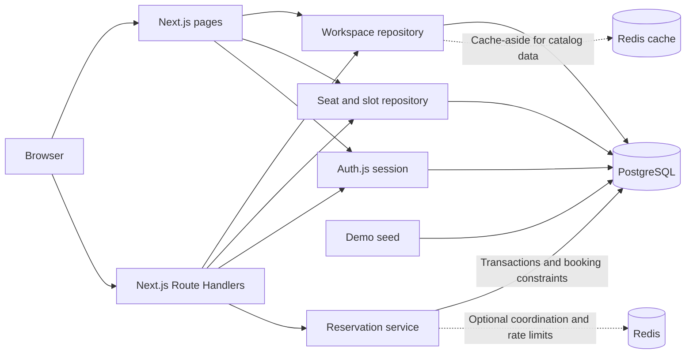
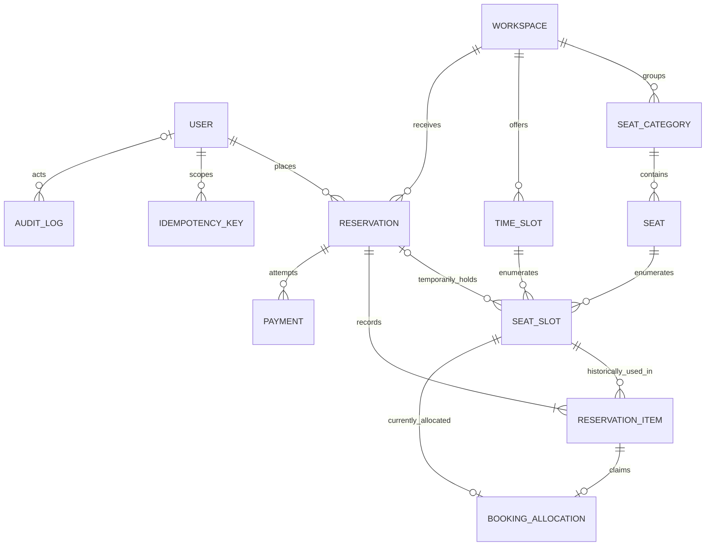

# SeatSync architecture and database design

Phases 1 through 5 implement discovery, authentication, interactive seat selection, database-backed reservations and optional Redis coordination and caching. Workspace content is fictional and seeded into PostgreSQL. The reservation, payment and deployment sections describe the planned implementation.

## Application boundaries

- **Browser and pages.** Server Components fetch and render catalog data. Browser state is useful for controls such as an open mobile filter panel and the future seat selection. The server always validates the submitted values before using them.
- **Route Handlers.** Turn HTTP requests into validated inputs and application calls. The handler owns response codes and the response envelope. Protected handlers resolve and verify the user session before reading private data.
- **Services.** The reservation and payment services will own business rules such as which status transitions are legal and which changes must commit together.
- **Repositories.** The catalog repository reads PostgreSQL through Prisma. Pages on the same Next.js server call the repository directly, saving a network round trip through their own API.
- **Infrastructure.** PostgreSQL stores reservation ownership, expiration and permanent allocations. Redis reduces contention and accelerates safe-to-cache reads. Two Next.js instances share both services.

## Dependencies and why we use them

The lockfile records the installed versions and supports repeatable installation with `npm ci`.

| Status | Dependency | Why |
| --- | --- | --- |
| Phase 1 | Next.js 16.4.6 and React 19.3.0 | The App Router runs pages and HTTP handlers in one app. React gives us reusable UI components and small client-side interaction boundaries. |
| Phase 1 | TypeScript 5 and ESLint 9 | Strict types catch programming mistakes before execution. Lint checks repository conventions and React usage. |
| Phase 1 | Tailwind 4.3.3 and its PostCSS plugin | Utility classes handle layout and spacing. CSS variables hold the product colors and seat state tokens. |
| Phase 1 | Local shadcn/ui-style Button and Skeleton, CVA, clsx and tailwind-merge | Components live in the source tree. CVA maps button props to classes, clsx combines class names and tailwind-merge resolves conflicting Tailwind classes. [shadcn/ui open-code approach](https://ui.shadcn.com/docs) |
| Phase 1 | Lucide, Geist and Motion | Provide icons, a self-hosted typeface and a small animation. Motion honors the browser’s reduced-motion setting. |
| Phase 1 | Zod 4 and `server-only` | Zod checks values arriving at runtime. The server-only marker protects the repository boundary against accidental client imports. |
| Phase 1 | Vitest 4.1.12 | Tests the same catalog Route Handlers that Next.js invokes. The Phase 2 suite runs against real PostgreSQL. Redis integration arrives with the locking phase. |
| Phase 2 | PostgreSQL on Neon, Prisma ORM 7.10.1, `@prisma/adapter-pg` and `pg` | SQL constraints and transactions protect shared inventory. Prisma provides typed queries and migrations. Use parameterized SQL where explicit row locks are needed. Use Neon’s pooled URL for application requests and a direct URL for migrations. [Prisma PostgreSQL guide](https://www.prisma.io/docs/orm/v7/core-concepts/supported-databases/postgresql) |
| Phase 2 | Auth.js (`next-auth` 4.24.15) and Node.js `crypto` | Stable Auth.js credentials and encrypted session cookies. Node’s scrypt implementation hashes passwords. PostgreSQL supplies the current role for protected requests. [Auth.js credentials provider](https://next-auth.js.org/providers/credentials) |
| Phase 3 | React availability hook | Fetch one snapshot at a time, pause while the tab is hidden, and refresh on return. |
| Phase 5 | Redis and ioredis | Coordinate short-lived operations across app instances. A hosted provider must support atomic acquisition and single-key scripts. Validate command support and pin the client when choosing the provider. |
| Phase 8 | Docker Compose, k6 and optional Nginx | Reproduce contention with two real app processes and shared infrastructure. The lightweight option runs the apps directly and containers for PostgreSQL and Redis. |
| Phase 9 | Vercel and hosted Redis | Use Node.js functions in a region near the data, with a local two-instance setup for load tests. Polling and database-driven expiration fit request-based hosting. |

## Database schema

| Model | Main fields and rules |
| --- | --- |
| `User` | ID, unique normalized email, display name, scrypt password hash, role (`USER`, `ADMIN`) and timestamps. Session identity is carried by an encrypted cookie. |
| `Workspace` | ID, unique slug, city, address, IANA timezone, category, description, amenities, photos, opening hours and listing status. Index city and category with listing status. |
| `SeatCategory` | Workspace, category name, display order and base price in paise per slot. Unique name within a workspace. |
| `Seat` | Workspace, category, visible code, grid position, active flag and admin-edit version. Unique code within a workspace. |
| `TimeSlot` | Workspace, UTC start and end, active flag and admin-edit version. Unique workspace and start time. Enforce a 30-minute duration and alignment to the half-hour grid. |
| `SeatSlot` | Workspace, seat, time slot, optional hold reservation and hold expiration. Unique seat and time slot. Check that the owner and expiration fields are set or cleared together. |
| `Reservation` | Owner, workspace, status, expiry, server-calculated amount, unique booking reference on confirmation, and lifecycle timestamps. Index owner with creation time and status with expiration. |
| `ReservationItem` | Reservation, seat-slot and snapshotted rate and seat label. Unique reservation and seat-slot. Preserve these rows after cancellation for receipts and history. |
| `BookingAllocation` | Reservation item and seat/time-slot pair tied to an existing seat-slot. Database unique constraint on `(seatId, timeSlotId)` and on the reservation item. The planned cancellation service deletes the active allocation in the same transaction as the status update. |
| `Payment` | Reservation, integer amount in paise, simulation attempt reference, status and timestamps. Unique attempt reference and a partial unique index allowing one successful payment per reservation. |
| `IdempotencyKey` | User, operation, key, canonical request hash, processing status, response status/body and creation time. Unique `(userId, operation, key)`. |
| `AuditLog` | Optional actor, entity type and ID, action, reason, request or instance identifier, and creation time. Index action with time for conflict statistics. Omit credentials, lock tokens and payment secrets from logs. |

Use composite foreign keys where workspace IDs appear on related rows. They prevent accidentally pairing a seat in one workspace with a slot in another. Reference the reservation’s workspace when recording holds. The Phase 2 migration enforces the booking allocation’s seat-slot and item relationship. Use database checks for positive amounts and slot duration where relevant. PostgreSQL can enforce relationships and uniqueness even when two app instances write at the same time. [PostgreSQL constraints](https://www.postgresql.org/docs/current/ddl-constraints.html)

Use PostgreSQL `timestamptz` for instants, UTC in API payloads, and the workspace’s IANA timezone (initially `Asia/Kolkata`) for display and generating the daily slot schedule. A price stored in paise avoids floating-point rounding during checkout. The catalog presents the seed’s whole-rupee prices after converting from paise.

## Reservation flow and upcoming integrations

1. **Read availability.** Time slots have pre-created inventory rows. Read live holds and permanent allocations from PostgreSQL. An expired hold is available if the seat has no active allocation. The browser can highlight multiple seats locally.
2. **Create a five-minute hold.** Authenticate and validate the request, normalize and sort the seat-slot keys, then lock the inventory rows in sorted order and use database time after the waits to check ownership and expiration. If any row is unavailable, return a conflict. Otherwise set all hold owners and expiries, and commit the reservation and price snapshots together. An optional Redis lease sits outside the database transaction. For requests with an idempotency key, the response commits in the same transaction as the hold.
3. **Confirm.** Take the same sorted inventory row locks, then lock the reservation row. Re-check owner, state, database time, inventory ownership and the exact successful payment amount. On success, conditionally transition `HELD` to `CONFIRMED`, insert every unique allocation, and clear the temporary holds in one transaction. Easebuzz sandbox verification runs before the booking transaction. Verified capture and successful confirmation commit together, and a completed confirmation can be replayed with its idempotency key.
4. **Cancel or expire.** Cancellation clears affected holds or deletes confirmed allocations transactionally and keeps the reservation items. Expired holds can be replaced on demand. A cleanup job can update historical statuses with the same lock ordering and clear only fields still owned by the expired reservation. The countdown can be reconstructed from the stored expiry after a refresh.
5. **Retry safely.** Retry only transient errors such as deadlock and serialization failures with bounded backoff and jitter. A lock timeout can produce a retryable 503. An expired reservation returns 410. An occupied seat, stale edit or mismatched idempotency request returns 409.

`HELD` can become `CONFIRMED`, `CANCELLED` or `EXPIRED`. `CONFIRMED` can become `CANCELLED` under the cancellation policy. Payment statuses are `PENDING`, `SUCCESS`, `FAILED` and `REFUNDED`.

**Pessimistic locking** means taking a row lock before checking and writing. Use `SELECT ... FOR UPDATE` on the contested seat-slot rows. **Optimistic locking** means reading a version and using it in a later conditional update. For example, update an admin’s seat edit where both `id` and `version` match, then increment the version. Zero rows updated signals a newer edit. A deterministic row order reduces deadlocks when two requests overlap on more than one seat. [PostgreSQL row locks](https://www.postgresql.org/docs/current/explicit-locking.html)

**Concurrency** means operations can overlap in time. **Parallelism** means they actually execute simultaneously. Two requests handled by one process can still interleave when either waits on I/O. The guarantee must hold in both cases.

## Redis coordination and caching

- Acquire a short lease with `SET seat-lock:{workspaceId}:{seatId}:{slotId} <random-token> NX PX <milliseconds>`. Use a server-generated unpredictable token per operation, acquire group keys in sorted order, and clean up only the keys this operation acquired. Use a single-key Lua compare-and-delete after commit or on failure. With a single-key script, Redis Cluster can route each release by its own key. Any future multi-key script must place all named keys in the same cluster hash slot, for example using the same hash tag. [Redis distributed lock pattern](https://redis.io/docs/latest/manual/patterns/distributed-locks/)
- When coordination Redis is available, publish a separate, expiring checkout hint after committing the hold. Use the reservation ID in the hint key and derive expiry from the database. If Redis restarts, a lease expires, or the process crashes, PostgreSQL still checks the active owner and deadline before granting a hold or confirming it.
- With **cache-aside**, read the cache first and fetch PostgreSQL on a miss. Start with short listing and metadata TTLs and invalidate affected cache keys or their version namespace after admin updates. Cache layouts as static metadata. Availability reads remain on the authoritative database path.
- Separate coordination and cache instances when practical. An LRU cache evicts older entries when space is tight. That is acceptable for reloadable workspace data. Active leases need a `noeviction` store or database fallback when Redis is constrained. Key prefixes and logical databases alone share a memory policy. [Redis eviction policies](https://redis.io/docs/latest/develop/reference/eviction/)

## Idempotency and retry example

The browser creates an `Idempotency-Key` once per intended operation and reuses it if the network response is lost. For a group hold, hash a canonical payload with sorted seat-slot keys. Scope each key to the authenticated user and operation. A second request with the same key waits for the unique row or reads the committed response. A changed payload with the same key receives a 409.

Persist the idempotency row, business changes and response inside one transaction. Committing means a retry can replay the completed result. Rolling back clears the unfinished claim and business changes together. A different key sent after successful confirmation is also covered by the reservation status check, unique seat allocations and one-successful-payment constraint.

## Phase plan and completion checks

| Phase | Work | Completion check |
| --- | --- | --- |
| 1. Catalog | Brand, discovery, workspace preview and shared catalog API | Eight entries, combined filters, stable pagination, route validation, responsive layout and build checks. |
| 2. Data and accounts | Prisma migration, fixtures as database seed, Auth.js, owner and role checks | Seed a clean local database, search from PostgreSQL, and verify anonymous, normal and admin permissions. |
| 3. Seat selection | Build the interactive grid, slot selector and database-backed availability API | Keyboard selection works, price updates locally and polling pauses or slows in hidden tabs. |
| 4. PostgreSQL reservation engine | Group holds, expiration and transaction-safe confirmation | Overlapping requests produce one owner, rollback leaves every group seat unchanged, and late confirmation fails. |
| 5. Redis coordination | Short leases, safe release, caching and rate limiting | Lease ownership stays safe across instances and PostgreSQL preserves correctness with Redis offline or empty. |
| 6. Checkout and payments | Refresh-safe timer, payment scenarios, idempotency, receipt | Replay yields a single payment and booking, elapsed holds are rejected, and receipts print. |
| 7. Dashboards | User history, cancellation and role-gated admin management with database metrics | Access is scoped to each user, admin changes use versions, and confirmed cancellation frees inventory. |
| 8. Engineering lab and load tests | Timelines, isolation, two app instances and k6 tests | Use seeded, distinct local users at 10, 50 and 100 concurrent requests. Verify a single hold winner and a single permanent booking. The lab’s unsafe comparison uses isolated data and is unavailable in production. |
| 9. Deployment and interview prep | Vercel/Neon/Redis setup, screenshots, results and implementation-based interview notes | Reproduce setup from the README and report measured local results and limitations. |
