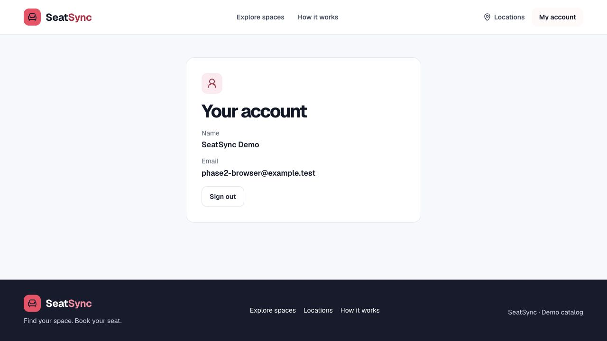
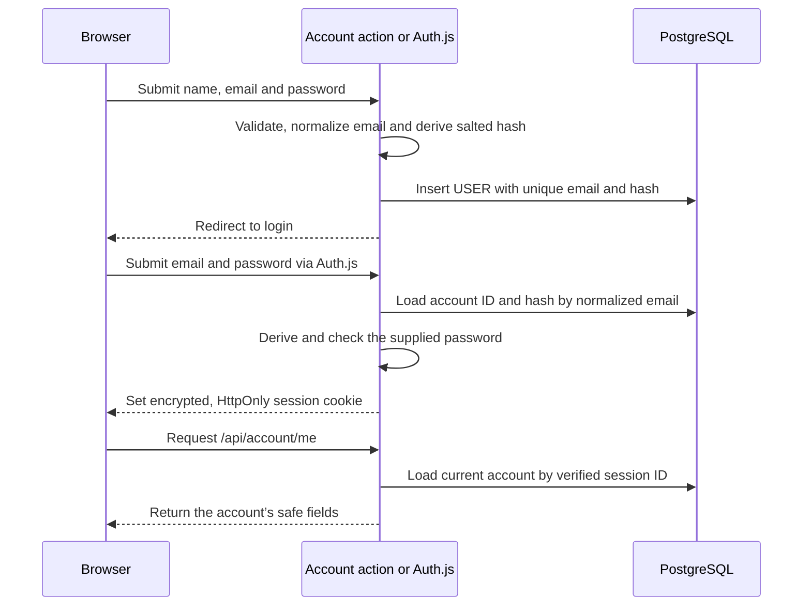

# Phase 2 guided walkthrough

Phase 2 adds durable data and accounts. The catalog now searches PostgreSQL. The schema already has the tables for future booking, payments and audit events, and the seed prepares the inventory the Phase 3 seat picker will read.

## 1. Compare the schema and the migration

Open [schema.prisma](../prisma/schema.prisma). A Prisma model describes a table, its columns and how it connects to other tables. Run `npm run db:generate` to turn the model definitions into the typed client imported by [database.ts](../src/lib/database.ts). Client generation creates TypeScript files in this repository. Applying a migration changes the database itself.

Then open the [initial SQL migration](../prisma/migrations/20261125124000_initial_schema/migration.sql). PostgreSQL runs that SQL exactly once per database and records it in its migration history. Read the `SeatSlot`, `ReservationItem` and `BookingAllocation` tables in that order:

| Table | What one row means |
| --- | --- |
| `SeatSlot` | One physical seat during one half-hour interval, with optional temporary hold ownership. The pair of IDs is the primary key. |
| `ReservationItem` | A historical line item with the selected seat label and price at the time of purchase. |
| `BookingAllocation` | The active permanent claim on a seat-slot. Its key also uses both IDs, so a second allocation for the same pair fails even if two app instances try to insert it. |

Composite foreign keys tie a seat and a time slot back to the same workspace. The SQL also enforces half-hour boundaries and keeps the hold owner and expiry paired. Payments can have many attempts, while a partial index allows at most one row in `SUCCESS` for each reservation. Phase 4 will add the transaction that checks a hold and writes all the required rows together.

## 2. Follow the seed

Open [workspace-fixtures.ts](../prisma/workspace-fixtures.ts), then [seed.ts](../prisma/seed.ts). The fixture file holds the eight fictional workspaces. The seed creates a workspace, its five seat categories, seats, seven days of scheduled slots, and one inventory row for every seat and slot combination.

Each workspace is prepared inside a database transaction. An error rolls back that workspace’s changes. Unique keys and `skipDuplicates` let you retry the seed without duplicating rows. The seed preserves existing workspace and inventory values and can add the next day’s slots when rerun later.

Opening hours are stored as local minutes after midnight. The seed uses Kolkata’s UTC+05:30 offset and stores actual slot timestamps as `timestamptz`. For example, 8:00 AM in Bengaluru corresponds to 02:30 UTC. Prices are stored in integer paise, so booking totals can be added exactly. The database has real inventory rows, while the current public cards show the labeled demo availability value.

## 3. Follow a database-backed search

Search for `Kadri` in the homepage. The URL and Zod validation from Phase 1 still work as before. Open [workspaces.ts](../src/repositories/workspaces.ts). It builds a Prisma filter, counts matching rows, and takes one page using SQL ordering, offset and limit. The count and page read share a repeatable snapshot, so an edit between them cannot produce a total from one snapshot and a page from another.

The repository maps the internal database row into the UI’s existing workspace object. The public ID is a stable slug such as `the-reading-room`. The database uses a UUID internally for joins. [The homepage](../src/app/page.tsx) streams its database section inside Suspense, so compiling the project does not require a running database. The same repository serves the [catalog endpoint](../src/app/api/workspaces/route.ts).

## 4. Trace account creation and login

- **Registration.** [Account forms](../src/components/account/account-forms.tsx) send data to a [Server Action](../src/app/account/actions.ts). The [account service](../src/services/accounts.ts) validates the form and hashes the password. PostgreSQL’s unique email constraint resolves simultaneous registrations, and the account repository converts a duplicate into a friendly form message.
- **Password hashing.** [passwords.ts](../src/lib/passwords.ts) uses scrypt with a different random salt for each password. Two users choosing the same password get different stored hashes. Login derives the key again from the entered password and the stored salt, then compares the bytes with Node’s timing-safe comparison. [OWASP password storage guidance](https://cheatsheetseries.owasp.org/cheatsheets/Password_Storage_Cheat_Sheet.html)
- **Authentication.** [auth.ts](../src/lib/auth.ts) configures the stable Auth.js credentials provider. Auth.js protects the login and logout requests with a CSRF token, then sets an encrypted session cookie with HttpOnly and Secure flags where appropriate. The cookie carries the account ID so it can be verified on the next request. [Auth.js session strategies](https://authjs.dev/concepts/session-strategies)
- **Authorization.** [current-user.ts](../src/services/current-user.ts) verifies the session and fetches the current user and role from PostgreSQL. [The private profile API](../src/app/api/account/me/route.ts) uses that ID, and [the admin page](../src/app/admin/page.tsx) checks the current role. Granting the role changes the decision on the next server request, even if the same user is still logged in.

## Files created or updated

| Files | Role |
| --- | --- |
| `prisma/`, `prisma7.config.ts` | Models, SQL migration, demo workspace data and repeatable seed. |
| `src/lib/database.ts`, `src/lib/server-env.ts`, `src/repositories/workspaces.ts` | Server environment checks, connection pooling and PostgreSQL-backed discovery. |
| `src/lib/auth.ts`, `src/lib/passwords.ts`, `src/repositories/accounts.ts`, `src/services/`, `src/validations/account.ts`, `src/types/next-auth.d.ts` | Credentials, hashing, user lookup, role and session types, and validation. |
| `src/app/account/`, `src/app/admin/`, `src/app/api/auth/`, `src/app/api/account/`, `src/components/account/`, `src/components/site-header.tsx` | Registration, login, private profile, sign-out and role-aware navigation. |
| `src/app/page.tsx`, `src/app/workspaces/[id]/page.tsx`, `src/app/globals.css`, `src/types/workspace.ts` | Request-time database reads, workspace address and account styling. |
| `compose.yaml`, `.env.example`, `scripts/grant-admin.ts`, package files and tests | Local database setup, database commands, privilege assignment and verification. |

## Acceptance checks

- Apply the migration to an empty development database and run the seed twice. A fresh week contains 8 workspaces, 224 seats, 1,393 scheduled time slots and 39,004 seat-slot rows.
- Verify the discovery API returns filtered results and a malformed query still returns 400.
- Register with a test email, try an incorrect password, then log in successfully and see the profile. Log out and observe HTTP 401 from the profile endpoint.
- Open `/admin` as a user. Grant the role from the terminal, reload with the same session, and see the administrator access page.
- Run `npm test`, `npm run test:integration`, `npm run db:validate`, `npm run lint`, `npm run typecheck` and the production build.

## Verified results

The migration and seed ran on a fresh local PostgreSQL 17.12 database. The second seed run kept the totals at 8 workspaces, 224 seats, 1,393 time slots and 39,004 seat-slot rows. A second migration run reported no pending migrations, and Prisma reported no schema differences for the features it compares. All 18 Vitest tests passed with database integration enabled. Lint, TypeScript and the Webpack production build passed.

The production build was also exercised in the browser with a synthetic account. Registration worked, an incorrect password was rejected, the correct password opened the account, a regular user was denied admin access, and the same session gained access after the database role changed. The profile endpoint denied a signed-out session.

## Try it yourself

Predict why a seat can have several `SeatSlot` rows but only one row with a particular time-slot ID. Then look up the two-column key in the migration. When two future booking requests both appear to succeed in the browser, explain which key PostgreSQL can use to reject the second confirmed allocation.
