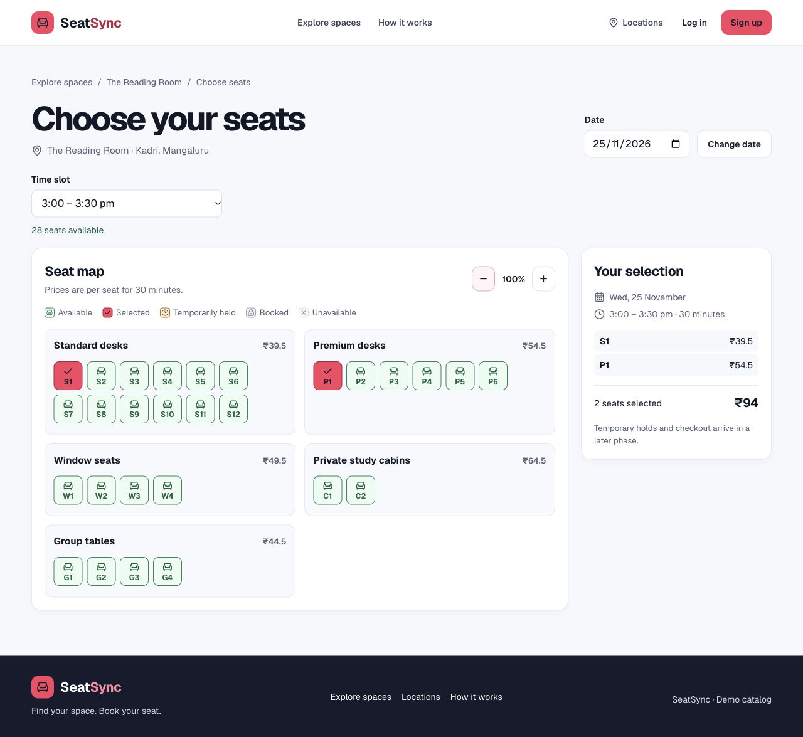
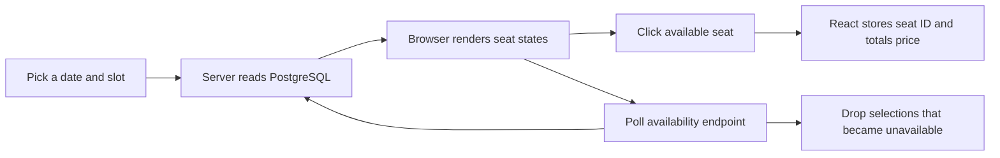

# Phase 3 guided walkthrough

Phase 3 connects the workspace details page to a seat picker backed by PostgreSQL. You can choose a date, a half-hour time slot and multiple seats. The browser totals the selected prices in paise. Creating a temporary hold is Phase 4.

## 1. Choose a date and read the schedule

Start at the [workspace details page](../src/app/workspaces/[id]/page.tsx). The [date form](../src/components/booking/booking-date-form.tsx) sends a GET request to `/workspaces/<slug>/seats?date=YYYY-MM-DD`. The [seat selection page](../src/app/workspaces/[id]/seats/page.tsx) validates the date, loads the layout and schedule, and passes the first availability snapshot to React.

Read `getUpcomingSlots` in the [seat repository](../src/repositories/seats.ts). The database converts the workspace’s local midnight and the following midnight into actual instants with `AT TIME ZONE`. The query keeps active slots that start inside that range after the current database time. The API sends each timestamp in UTC. The picker formats the result using the workspace’s timezone.

For example, a slot starting at 03:30 UTC displays as 9:00 AM in a workspace in `Asia/Kolkata`. For a known workspace, a day without future slots returns an empty list. This can happen after closing or outside the seven days of seeded inventory. Rerunning `npm run db:seed` against a development database adds the next seven days and keeps the existing rows.

The tests uncovered a timezone problem in the Phase 2 connection setup. Prisma could send a date parameter without a timezone offset, and a PostgreSQL session using IST would interpret it as IST. [database.ts](../src/lib/database.ts) now opens connections in UTC. The code still uses each workspace’s timezone when interpreting calendar dates and displaying slot labels. The existing Neon seed opened The Reading Room at 7:00 AM IST as expected.

## 2. See what a seat can be

Open `getSeatAvailability` in the [seat repository](../src/repositories/seats.ts). One SQL statement joins the time slot, seats, their inventory, and confirmed allocations. PostgreSQL evaluates the rows at one consistent point in time. The interpolated slug and slot ID are query parameters.

| Database facts | State sent to the browser |
| --- | --- |
| Seat or slot is inactive, the slot has started, or there is no inventory row | Unavailable |
| An active allocation exists for the seat and slot | Booked |
| Inventory has a hold expiry later than the database’s statement time | Temporarily held |
| Inventory exists and neither a booking nor an unexpired hold blocks it | Available |

The shared response includes each seat ID and state, plus the timestamp of the check. The hold owner stays on the server. Because the SQL checks the expiry as it reads, a seat can become available before a background process clears the expired hold.

## 3. Follow a click

In [seat-map.tsx](../src/components/booking/seat-map.tsx), each seat is a button with a status label, a matching icon, and `aria-pressed` for keyboard and screen-reader use. The map uses each seat’s grid row and column. The zoom controls change the cell size. The section prices are per seat for 30 minutes.

In [seat-picker.tsx](../src/components/booking/seat-picker.tsx), clicking an available seat adds or removes its ID from a React state array. The summary looks up each selected seat’s category price, adds the integer paise, and formats the total in rupees. Selecting a different time slot starts a fresh selection, since the same seat can be available at 9:00 AM and booked at 9:30 AM.

## 4. Follow the polling request

Read [use-seat-availability.ts](../src/hooks/use-seat-availability.ts). It makes a fresh request when you choose a slot, waits 12 seconds after the request finishes, and checks again. Waiting for the previous request keeps slow requests from stacking up. A hidden tab cancels polling and aborts any in-flight request. Returning to the tab triggers an immediate refresh.

Suppose you select seat S1. If the next database snapshot reports S1 as held or booked, the picker removes it from your selection and explains what happened. Phase 4 will also check the database inside the transaction that creates a hold, because a seat can change between the last poll and an attempted reservation.

## API

| Endpoint | Response |
| --- | --- |
| `GET /api/workspaces/[id]/seats` | Seat layout, categories and prices in paise. |
| `GET /api/workspaces/[id]/slots?date=YYYY-MM-DD` | Future slots for a workspace’s local calendar date, ordered by start time. |
| `GET /api/seats/availability?workspaceId=<slug>&slotId=<uuid>` | Current seat states for that workspace and slot. |

The APIs use the catalog’s response format. Invalid parameters return 400. An unknown workspace or a slot that belongs to a different workspace returns 404. The schedule and seat state responses include `Cache-Control: no-store` so a browser or proxy has to fetch fresh data.

## Files and verification

| File or group | Role |
| --- | --- |
| `src/app/workspaces/[id]/page.tsx`, `src/app/workspaces/[id]/seats/page.tsx` | Booking entry point, validated date and time, and server-rendered first snapshot. |
| `src/app/api/workspaces/[id]/seats/`, `src/app/api/workspaces/[id]/slots/`, `src/app/api/seats/availability/` | Public layout, schedule and availability endpoints. |
| `src/components/booking/`, `src/hooks/use-seat-availability.ts` | Interactive seat map, responsive summary, accessible controls and polling. |
| `src/repositories/seats.ts`, `src/validations/booking.ts`, `src/lib/booking-format.ts`, `src/types/booking.ts` | Database reads, request validation, timezone and money formatting, and response types. |
| `src/lib/database.ts` | Configures database sessions to interpret timestamp parameters in UTC. |
| `tests/seats.test.ts`, `tests/postgres.integration.test.ts` | Request validation plus real database tests for layout, dates, seat states and cross-workspace IDs. |

Acceptance checks include selecting seats by keyboard, changing dates and slots, verifying the sum for two different categories, finding an empty date, and checking that a new hold removes a selected seat on the next refresh. Use an isolated migrated and seeded database for `npm run test:integration`.

**Verified.** All 27 Vitest tests passed against the isolated PostgreSQL database. The browser checks confirmed that S1 and P1 total ₹94 in The Reading Room, the mobile summary fits a 390-pixel viewport, and polling disables and removes a selected seat after a synthetic hold is written to the local test database. TypeScript, lint and the Webpack production build also passed.

**Try it yourself.** In a workspace pick S1 and P1, then change the time slot. Open the availability request in the browser’s Network panel and compare the seat IDs in the response to the layout endpoint. Which value stays the same for the physical seat, and which value identifies the half-hour interval?
