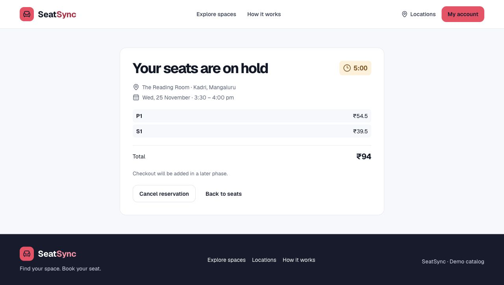
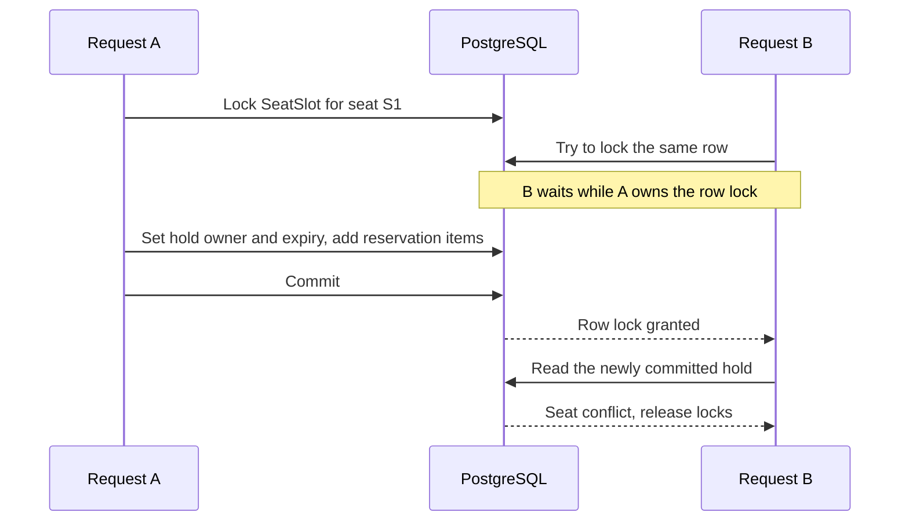

# Phase 4 guided walkthrough

Phase 6 connects the hold to the **Pay ₹…** action. The steps below describe the original Phase 4 interface.

Phase 4 implements the PostgreSQL reservation engine. A signed-in user can hold a group of seats, reopen the hold page, and cancel before the slot starts. PostgreSQL owns the hold deadline and prices. The confirmation transaction requires a matching successful payment recorded by the server. The browser payment simulator and request idempotency keys come in Phase 6.

## 1. Start with the request

In the [seat picker](../src/components/booking/seat-picker.tsx), **Hold seats** sends the workspace slug, time-slot ID and seat IDs to [the hold endpoint](../src/app/api/reservations/hold/route.ts). [The HTTP boundary](../src/lib/reservation-http.ts) checks the session and validates the request’s origin and content type. [The request schema](../src/validations/reservation.ts) accepts up to 50 distinct seat IDs for one slot. The server derives ownership from the session and reads prices from PostgreSQL.

You can select a seat locally while another visitor is selecting the same seat. Clicking **Hold seats** is when the app asks PostgreSQL to grant ownership. A losing request gets a 409. The browser names the affected seats and immediately refreshes availability.

## 2. Follow the competition into PostgreSQL

In `createHold` in the [reservation service](../src/services/reservations.ts), the transaction takes shared locks on the workspace and slot, then locks each requested inventory row exclusively in seat-ID order. Two people holding different seats can share the workspace and slot locks. Two people trying to change the same seat and slot have to take turns.

Read `lockInventory` and `readLockedInventory` in the [inventory repository](../src/repositories/reservation-inventory.ts). They are separate SQL statements for a reason. At PostgreSQL’s Read Committed isolation level, a new statement can see changes committed while the first statement waited. That matters when the first transaction inserts a booking allocation in a different table. The second statement also locks the seat and category rows in shared mode while reading availability and price. [PostgreSQL isolation](https://www.postgresql.org/docs/17/transaction-iso.html) · [PostgreSQL row locking](https://www.postgresql.org/docs/17/explicit-locking.html)

Every requested seat must pass the test. The conditional update claims only rows with free or expired holds and no active allocation. The service checks the affected-row count, then writes the reservation item and price for each seat. Creating the reservation, setting the owners, and writing the item prices use one transaction. If an update or insert fails, PostgreSQL rolls them back together.

## 3. Trace the deadline

The server asks PostgreSQL for `clock_timestamp()` after acquiring the locks. The deadline is the earlier of the configurable hold TTL, which defaults to 300 seconds, and the start of the slot. The [reservation page](../src/app/reservations/[id]/page.tsx) reads the recorded deadline again on refresh, and the [countdown](../src/components/booking/reservation-details.tsx) uses that deadline and the server’s check time to display the remaining seconds.

The display can lag by the time it takes to send the response. The database clock decides whether confirmation can go through. An expired hold is available to another request immediately. Reading a reservation derives its effective status from the deadline. An expired cancel or confirm also marks the record expired and clears inventory still owned by that reservation.

## 4. Confirm and cancel safely

In `confirmReservation` in the [reservation service](../src/services/reservations.ts), the server reads the immutable items, locks the same inventory in the same order, then locks the reservation row and re-reads it. It checks ownership, the deadline, exact hold ownership on every seat, and a successful payment for the exact total. The final SQL update checks the deadline again with the database clock as it changes `HELD` to `CONFIRMED`.

The database’s unique seat-slot allocation constraint is a final guard. Creating the allocation rows, assigning the booking reference and clearing the temporary holds all commit together. A repeated confirmation of the same reservation returns its existing booking reference. The later idempotency-key phase will add replay of whole HTTP requests.

A user can cancel a hold or confirmed reservation before the slot starts. For a confirmed reservation, cancellation deletes the active allocations and keeps the reservation items and reference. Repeating cancellation returns the current cancelled record. Cancelling an expired hold cannot clear somebody else’s newer hold because the release checks the old reservation ID.

## 5. Understand the trade-offs

A **pessimistic lock** waits before making a decision, which is appropriate when many people want the same seat. A **conditional write** compares the actual state at the moment of update. SeatSync uses both for inventory and lifecycle changes. The existing version fields on seats and slots will support optimistic admin edits later, where the editor submits the version it previously read.

Lock acquisition follows a consistent order to reduce deadlocks. The [transaction wrapper](../src/services/reservation-transaction.ts) sets a 1.5-second lock wait limit and retries recognized SQL lock timeouts, serialization conflicts, or deadlocks up to three attempts, with a short jittered delay. It returns 503 if contention persists. The five-minute checkout window is stored data. A database transaction holds row locks only while a server request is making its changes. [Prisma transaction options](https://www.prisma.io/docs/orm/prisma-client/queries/transactions)

## API routes

| Request | Behavior |
| --- | --- |
| `POST /api/reservations/hold` | Accepts JSON with `workspaceId`, `slotId`, and `seatIds`. Returns 201 with the reservation and deadline. On a seat conflict, 409 includes `error.unavailableSeatIds`. |
| `GET /api/reservations/[id]` | Returns the signed-in owner’s reservation, including an expired status when appropriate. |
| `POST /api/reservations/[id]/cancel` | Accepts JSON. Releases the hold or active allocations and returns the cancelled record. |
| `POST /api/reservations/[id]/confirm` | Accepts JSON. Returns 409 until there is a matching successful server-side payment. An expired hold returns 410. |

Responses use `Cache-Control: private, no-store`. Unsigned requests receive 401, and a reservation belonging to a different account is treated like an unknown ID and returns 404. The Phase 2 schema already has the required tables and constraints.

## Files changed

| Files | Role |
| --- | --- |
| `src/services/reservations.ts`, `src/services/reservation-transaction.ts`, `src/services/reservation-error.ts` | Reservation state changes, transaction retry limits and domain errors. |
| `src/repositories/reservation-inventory.ts`, `src/repositories/reservations.ts` | Row locking, clock reads, inventory release and the private response fields. |
| `src/app/api/reservations/`, `src/lib/reservation-http.ts`, `src/validations/reservation.ts`, `src/lib/server-env.ts` | Authenticated routes, input validation and TTL configuration. |
| `src/app/reservations/[id]/`, `src/components/booking/`, `src/hooks/use-seat-availability.ts`, `src/types/booking.ts` | Seat picker handoff, conflict refresh, countdown, cancellation and shared types. |
| `tests/reservation-api.test.ts`, `tests/reservations.integration.test.ts` | HTTP-boundary tests and contention checks against real PostgreSQL. |

## Acceptance checks

- Ten requests for one seat and slot produce one hold. Overlapping groups leave the losing request’s other seat free.
- The same seat can be held for different slots. Cancelling releases the seats while preserving history.
- A second user receives 404 for private reservation operations.
- Confirmation requires a matching successful payment. Three competing confirmation requests return one booking reference and one allocation per seat.
- Confirmation after expiry returns 410, including when the deadline passes while a request waits on a row lock.
- In the browser, sign in, hold a group, refresh to see the same deadline, cancel, and reopen the picker to see the released seats.

**Verified.** All 39 Vitest tests passed against local PostgreSQL 17, along with lint and the Webpack production build, which ran TypeScript checking. In the browser, the countdown went from 5:00 to 4:47 after refresh. Cancellation persisted after another refresh, and both seats appeared available on the picker.

**Try it yourself.** Follow Request B in the diagram and find the two SQL statements it runs after A commits. Explain what could go wrong if B checked for availability once before waiting and then used that answer to write its hold.
