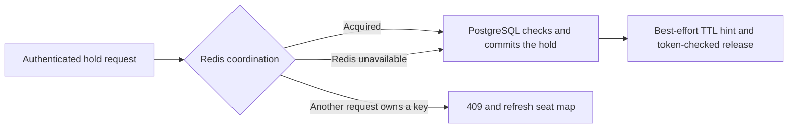

# Phase 5 guided walkthrough

Phase 5 adds Redis coordination to the PostgreSQL reservation engine. PostgreSQL still checks the current owner, expiry and permanent allocations on every write.

## 1. Set the environment variables

| Variable | What the app uses it for |
| --- | --- |
| `REDIS_URL` | Shared Redis connection for seat coordination, the hold TTL hint and rate limiting. Paste only the `redis://...` or `rediss://...` URL from the provider’s connection instructions. |
| `REDIS_CACHE_URL` | Optional second Redis service for cacheable workspace data. Leave this empty if you have one Redis database. The app reads PostgreSQL directly for catalog requests in that case. |
| `APP_INSTANCE_ID` | Optional label for a running copy of SeatSync. If blank, the process generates a label. With two local processes you can use values like `instance-a` and `instance-b` and see them in the reservation API’s `X-SeatSync-Instance` header. |
| `RESERVATION_TTL_SECONDS` | Maximum hold duration. It defaults to 300 seconds. The start of the slot can make a hold shorter. |

The configuration accepts a TCP Redis URL. For a hosted TLS endpoint, use its `rediss://` URL with the provider’s trusted certificates available to Node. Local Redis can use `redis://127.0.0.1:6379`. [Redis Cloud TLS documentation](https://redis.io/docs/latest/operate/rc/security/database-security/tls-ssl/)

With Docker already installed, `docker compose up -d redis` starts coordination Redis on localhost. `docker compose --profile cache up -d redis-cache` starts the optional cache on port 6380. Neon can still provide PostgreSQL while both Redis processes run locally.

## 2. Follow a hold request

1. The [reservation HTTP code](../src/lib/reservation-http.ts) authenticates the user and checks their write rate limit.
2. [Seat coordination](../src/services/seat-coordination.ts) constructs a key for each workspace, seat and slot, such as `seat-lock:the-reading-room:<seat-id>:<slot-id>`. Every app instance uses the same key for the same seat and slot. It sorts the keys and attempts `SET key token PX 8000 NX` for each. `NX` means only set a missing key. `PX` gives the key an eight-second expiry. Redis performs both conditions as one operation.
3. If another request holds a key, the wrapper releases any keys it acquired and returns a 409 `SEAT_COORDINATION_BUSY`. The seat picker refreshes. If connecting or sending commands fails, the wrapper releases whatever it can and proceeds through the PostgreSQL engine.
4. The [reservation service](../src/services/reservations.ts) runs the Phase 4 transaction. Every requested seat must pass PostgreSQL’s availability checks. After commit, the service writes a separate `reservation-hold:<reservation-id>` hint whose TTL ends at the PostgreSQL deadline.
5. The coordinator releases its locks after the database work. A Lua script deletes each key only when its current token matches the caller’s token.



Each Lua invocation touches one key. Redis Cluster requires any keys used together by a script to be in the same hash slot. A future multi-key script would need intentional key placement with hash tags. The current client connects to a single Redis endpoint. [Redis locking pattern](https://redis.io/docs/latest/develop/clients/patterns/distributed-locks/) · [Redis EVAL documentation](https://redis.io/docs/latest/commands/eval/)

## 3. Separate the short lock, the hold and the user

A **coordination lock** protects a brief server operation. Its token is random and unique to that operation. For example, if request A stalls until its key expires and B then acquires the key, A’s cleanup script sees B’s token and leaves it alone.

The **reservation hold** lasts until the stored deadline. PostgreSQL records the reservation, its user, prices and seat ownership. The short Redis lock is released when the request finishes, so it doesn’t stay locked through the five-minute window. The TTL hint is best-effort and the app’s authorization and availability checks read PostgreSQL.

For cancellation and confirmation, the service reads the owned reservation before deriving coordination keys and verifies ownership again inside the database transaction. Somebody with a reservation ID still needs the account that owns it. If Redis restarts, loses a key, or its lease expires early, PostgreSQL row locks, expiry checks and allocation uniqueness still apply.

## 4. Understand the cache and rate limit

[The optional catalog cache](../src/lib/catalog-cache.ts) reads Redis first, falls back to PostgreSQL on a miss, and stores the response with a short TTL. Homepage and listing responses last 30 seconds, seat layouts last 60 seconds, and workspace details last 90 seconds. When the seed completes, it switches the cache generation. Old entries then expire, and a read that started before invalidation can only fill the old generation. Live availability, reservation details and upcoming time-slot reads go directly to PostgreSQL.

An LRU cache evicts keys that haven’t been used recently when it needs memory. Workspace metadata can be reloaded, so this is a good fit. A lease may need to exist even if nobody reads it again until release. That’s why local Compose uses `noeviction` for coordination Redis and `allkeys-lru` for the optional cache. [Redis eviction policies](https://redis.io/docs/latest/develop/reference/eviction/)

[The rate limiter](../src/services/reservation-rate-limit.ts) increments one Redis counter per signed-in user and sets a 60-second expiry atomically. The first 30 reservation writes per minute can proceed. Additional writes return HTTP 429 with `Retry-After`. When Redis is unavailable, reservation writes still go through PostgreSQL.

## Files changed

| File or group | Role |
| --- | --- |
| `src/lib/redis.ts`, `src/lib/server-env.ts`, `src/lib/app-instance.ts` | Optional connections, timeouts, environment validation and the per-instance label. |
| `src/services/seat-coordination.ts`, `src/services/reservations.ts`, `src/services/reservation-error.ts` | Ordered leases, token-checked release, TTL hint and the PostgreSQL fallback. |
| `src/lib/reservation-http.ts`, `src/services/reservation-rate-limit.ts` | Shared write limit and instance response header. |
| `src/lib/catalog-cache.ts`, `src/repositories/workspaces.ts`, `src/repositories/seats.ts`, `prisma/seed.ts` | Cache-aside reads and invalidation. |
| `.env.example`, `compose.yaml`, `vitest.config.mts`, `tests/redis-*.test.ts` | Documented settings, local Redis services and isolated tests. |

## Run the integration tests

Use a migrated, seeded local PostgreSQL database and disposable local Redis instances. Start Redis through Compose or an existing local installation.

```bash
SEATSYNC_TEST_REDIS_URL=redis://127.0.0.1:6379 \
SEATSYNC_TEST_REDIS_CACHE_URL=redis://127.0.0.1:6380 \
npm run test:integration
```

Omit `SEATSYNC_TEST_REDIS_CACHE_URL` when running without the optional cache service. Vitest leaves the ordinary application Redis URLs unused so the tests can’t change hosted Redis data.

## Try two app instances

Point the app at the same local PostgreSQL and Redis services for both processes. Build once with `npm run build -- --webpack`, then start each command in its own terminal.

```bash
APP_INSTANCE_ID=instance-a AUTH_URL=http://127.0.0.1:3141 npm start -- -H 127.0.0.1 -p 3141
APP_INSTANCE_ID=instance-b AUTH_URL=http://127.0.0.1:3142 npm start -- -H 127.0.0.1 -p 3142
```

Open each address in a separate browser profile, sign in with different accounts, and choose the same seat and time slot in both. Submit the holds close together. Inspect `POST /api/reservations/hold` in each browser’s Network tab for HTTP 201 or 409 and the `X-SeatSync-Instance` header.

Phase 5 passed all 47 tests with isolated PostgreSQL and Redis services. A concurrent HTTP check returned 201 and 409 from different processes. The owner cancelled through the other process, and a separate signed-in user received 404. The hold key had a TTL after creation and disappeared after cancellation.

**Try it yourself.** Imagine app A loses its Redis connection after PostgreSQL commits a hold. A later request arrives at app B after all Redis keys are gone. Find where B must check PostgreSQL and explain why it still sees the seat as held.
